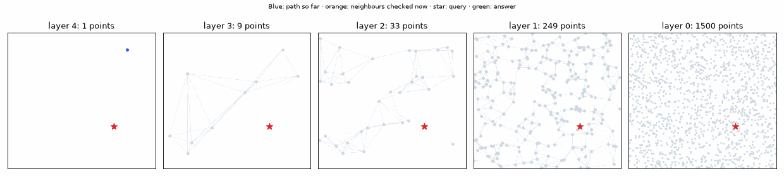
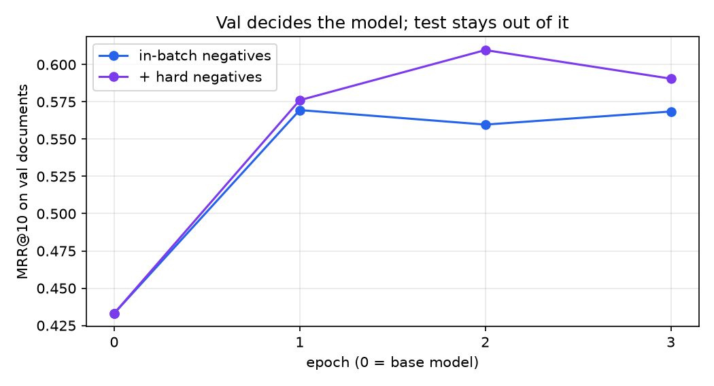
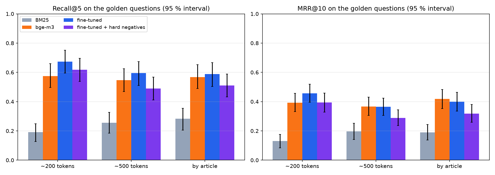
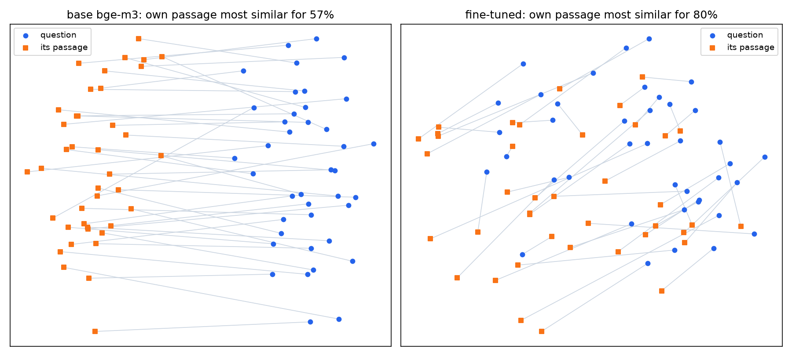
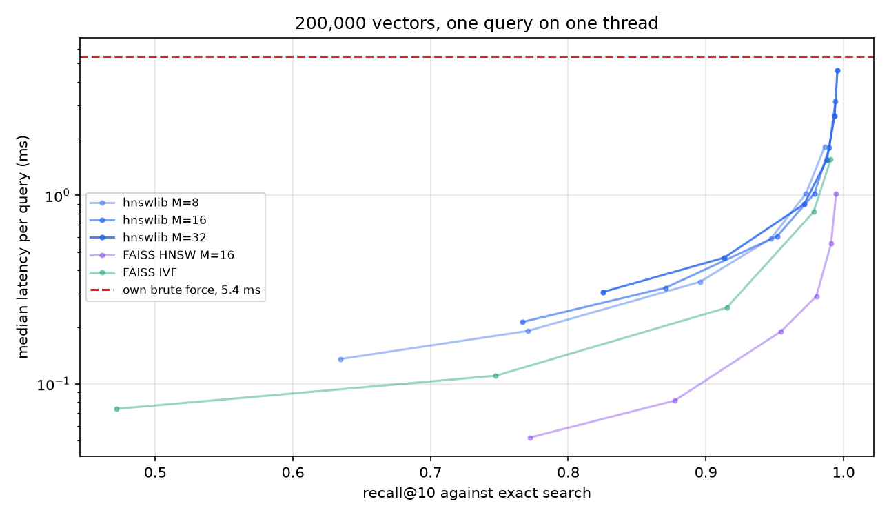

# 14 · Embeddings & retrieval on Slovak insurance terms

🇸🇰 [Slovenská verzia](README.sk.md) · 📘 [Step-by-step tutorial](TUTORIAL.md)

## TL;DR
- Finding the right clause for a customer's Slovak question in real insurance terms: **BM25 recall@5 0.191, base bge-m3 0.574**, on 141 hand-reviewed questions from insurers never seen in training.
- Fine-tuning with in-batch negatives reached **0.674** (MRR 0.392 → 0.456). The gain is close to the edge of the noise: +0.099 on recall@5, paired 95 % interval −0.000 to 0.199.
- **Validation chose the wrong model.** Hard negatives won on val (MRR 0.610 vs 0.569) and lost on the golden set (recall@5 0.617). I kept the val choice, so the reported model shows no provable gain over base.
- The cause is visible: both tuned models improve long questions (0.55 → 0.73) and get worse on short ones (0.63 → 0.54). Training questions were long.
- On 200,000 vectors, exact search takes **5.4 ms** per query, and FAISS HNSW **0.19 ms** at recall 0.955. For this insurance corpus of about 1,000 chunks, an approximate index is not needed at all.

## Problem
A RAG system is only as good as what it retrieves. This step answers three questions before step P7 builds on them: how far does an off-the-shelf multilingual model get on Slovak legal-style text, does fine-tuning help on documents it has never seen, and when do you need an approximate index?

No Racing Lab chapter: retrieval is about text, and the cars have none. The visual example is a query descending through my own HNSW.



## Setup
- **Corpus:** 20 public Slovak insurance terms from 12 sources, 457 PDF pages. PDFs and text stay in `data/`, the URLs are in `corpus.py`.
- **Split by insurer, before anything else:** 11 train documents, 3 val (Wüstenrot, mBank), 6 test (Generali, UNIQA, Union). Insurers share boilerplate, so a split inside one insurer would leak. Between 1.6 % and 11.1 % of a held-out document's 8-word runs also occur in train.
- **Golden set:** 141 questions, in `golden.json`.
- **Training:** 1,399 question–passage pairs from train documents.
- **Models:** `BAAI/bge-m3`, dense vectors only, normalised.
- **Hardware:** Mac mini M4 Pro, 48 GB, MPS. Metrics: recall@1/5/10, MRR@10, nDCG@10, bootstrap 95 % intervals over questions.

## How it works

**Labels are evidence spans, not chunks (`make_questions.py`).** A label is a document id and character offsets of the sentence that answers. A chunk counts as relevant if it covers at least 80 % of that span, or holds the same words, because two documents of one insurer can contain the identical clause. So every chunking strategy is scored against the same answers, and the scoring code in `common.py` never changes.

**Questions.** A local model reads a passage, writes a customer's question, and quotes the answer. The quote must be found in the passage, or the question is dropped. Exact matching first rejected 40 %, because PDF extraction leaves "b ola" and "pre -\nskúmať" in the text while the model writes the clean word. Matching on letters only fixed it.

**Golden set, read one by one.** `gemma3:12b` wrote the candidates and Claude read all 190; the owner did not. 49 were dropped: 16 unnatural or off-product, 13 where the evidence did not answer, 10 fragments too short to judge, 8 duplicates, 2 needing the document open. 20 were reworded. Every decision is in `review_golden.py`.

**Training pairs.** `qwen3:30b-a3b` wrote them from train documents. Claude read every 10th, 140 in total: 11 had evidence that only loosely answers, and they stayed in, because only the golden set was fixed by hand.

**Fine-tuning (`train_embed.py`).** In a batch of 8, each question's passage is the positive and the other 7 are negatives: `MultipleNegativesRankingLoss`, 3 epochs, learning rate 2e-5, best epoch by val MRR. Batch 16 ran out of GPU memory and macOS killed the process without a Python error.

**Hard negatives, and a bug worth keeping.** The second run adds a passage the base model wrongly ranks high. My first version mined 200-token chunks while positives were shorter passages, and treated neighbours overlapping the answer as negatives. Val MRR fell from 0.433 to 0.185–0.277, and recall@5 was worst on long article chunks (0.078). The pattern suggests the model learned that long text is wrong. Mining the same passage format and skipping overlaps fixed it.



**My own indexes (`index.py`).** `BruteForce` is a normalised dot product plus `argpartition`. `TinyHNSW` is a small HNSW in NumPy: each point gets a random top layer, upper layers are sparse highways, search walks greedily down them and only the bottom layer gets a wider search. On 1,500 2D points it builds layers of 1,500 / 249 / 33 / 9 / 1 points and reaches recall@5 of 0.998 with `ef` 5 and 1.0 from `ef` 10.

## Results

**Retrieval, 141 golden questions, ~200-token chunks.** The chosen model was fixed on val before these numbers existed.

| System | Recall@1 | Recall@5 (95 %) | Recall@10 | MRR@10 (95 %) | nDCG@10 |
|---|---|---|---|---|---|
| BM25 | 0.078 | 0.191 (0.128–0.248) | 0.248 | 0.130 (0.085–0.175) | 0.158 |
| bge-m3, base | 0.248 | 0.574 (0.496–0.660) | 0.702 | 0.392 (0.331–0.457) | 0.467 |
| Fine-tuned, in-batch | 0.291 | **0.674** (0.596–0.752) | **0.809** | **0.456** (0.395–0.518) | 0.541 |
| Fine-tuned + hard negatives (**chosen on val**) | 0.270 | 0.617 (0.539–0.695) | 0.709 | 0.394 (0.329–0.458) | 0.469 |

Paired on the same questions, against base:

| Model | Recall@5 difference (95 %) | MRR@10 difference (95 %) |
|---|---|---|
| Chosen (hard negatives) | +0.043 (−0.071 to 0.142) | +0.001 (−0.084 to 0.081) |
| In-batch | +0.099 (−0.000 to 0.199) | +0.064 (−0.013 to 0.141) |

In-batch beat the chosen model on MRR by 0.062 (0.008 to 0.118). I did not switch to it: that would be choosing on the test set, and the number would no longer mean anything. The table shows both, and the honest reading is that val failed here.

**Chunking.** Recall@5 / MRR@10:

| Strategy | Chunks | Mean characters | Evidence reachable | BM25 | Base | In-batch | Hard negatives |
|---|---|---|---|---|---|---|---|
| ~200 tokens, overlap 40 | 1,113 | 741 | 98.6 % | 0.191 / 0.130 | 0.574 / 0.392 | 0.674 / 0.456 | 0.617 / 0.394 |
| ~500 tokens, overlap 100 | 446 | 1,851 | 100 % | 0.255 / 0.196 | 0.546 / 0.366 | 0.596 / 0.365 | 0.489 / 0.288 |
| By article heading | 527 | 1,510 | 100 % | 0.284 / 0.189 | 0.567 / 0.418 | 0.589 / 0.400 | 0.511 / 0.318 |



For base bge-m3, chunking stays inside the noise. Fine-tuned models lose more on long chunks, because they trained on short passages. BM25 gets better with longer chunks: more words to match.

**In 2D.** A sample of 40 questions with their passages, PCA fitted per model. The base model keeps questions and passages in two separate clouds; tuning mixes them. In the full 1,024 dimensions, the own passage is the closest of the 40 for 57 % of questions before and 80 % after. PCA is only an illustration, and this is an easier task than searching the full corpus.



**Index benchmark: 200,000 Slovak Wikipedia passages, 1,024 dimensions, 2,000 queries, recall@10 against exact search.** Latency is for one query on one thread.

| Index | Setting | Recall@10 | Median | p95 | Build | Size |
|---|---|---|---|---|---|---|
| Own brute force | | 1.000 | 5.45 ms | 5.94 ms | 0 | 819 MB |
| hnswlib | M 16, ef 50 | 0.952 | 0.61 ms | 0.79 ms | 54 s | 849 MB |
| hnswlib | M 16, ef 200 | 0.990 | 1.79 ms | 2.27 ms | 54 s | 849 MB |
| FAISS HNSW | M 16, ef 50 | 0.955 | **0.19 ms** | 0.24 ms | 22 s | 848 MB |
| FAISS HNSW | M 16, ef 200 | 0.991 | 0.56 ms | 0.71 ms | 22 s | 848 MB |
| FAISS IVF | nprobe 16 | 0.915 | 0.25 ms | 0.29 ms | **2.8 s** | 825 MB |
| FAISS IVF | nprobe 128 | 0.991 | 1.55 ms | 1.68 ms | 2.8 s | 825 MB |



Size barely changes, because the vectors dominate it; the graph adds a few percent. HNSW is about 29× faster than exact search at recall 0.955, and going from recall 0.955 to 0.991 costs about 3× more time. Both libraries run the same algorithm, so hnswlib's gap to FAISS here is at least partly how each is called from Python. I did not separate that.

## Error analysis
On the chosen model: 33 questions entered the top 5, 27 left it, 54 are still missing, and 41 are not in the top 10.

- **Question length decides it.** This is the main finding:

| Questions | Count | Base | In-batch | Hard negatives |
|---|---|---|---|---|
| Under 80 characters | 41 | 0.634 | 0.537 | 0.488 |
| 80 characters or more | 100 | 0.550 | 0.730 | 0.670 |

  Training questions average 144 characters, golden ones 108. The model learned long, situation-heavy questions and got worse at the short direct ones a customer also types. Val questions came from the same writer as train (141 characters), so val could not see this, which is why it chose wrongly.
- **By document.** UNIQA travel terms gained most (0.41 → 0.63), while `uniqa_dcr` (0.62 → 0.52) and `union_vpp` (0.59 → 0.56) lost. With 13–29 questions per document, treat these as hints.
- **Cross-document near-duplicates.** Similar clauses in several documents compete, and a question rarely says which insurer it means. Some "misses" are correct clauses from the wrong document.
- **BM25** suffers from inflection and vocabulary: customers write "ukradli" where terms say "odcudzenie". It has no stemming here.

## What I learned
- **When does fine-tuning embeddings pay off?** When the gap is between how people ask and how documents are written, and when training questions look like real ones. The gain here was real on questions shaped like the training data and negative on the others. Fine-tuning moves the model towards its training distribution, so that distribution has to be right.
- **A val set from the same source as train measures the wrong thing.** The golden set exposed what val could not: a different writer. Selection data should differ from training data the way production does.
- **Do not re-pick after seeing test.** It was tempting. Reporting the worse number with the reason is worth more than a better number nobody can trust.
- Negatives teach whatever differs from the positives. If that is length, the model learns length.
- A silent process death can be memory: no traceback does not mean no cause.
- Do not reach for an index by reflex. 5 ms exact search over 200,000 vectors is fine for most RAG systems.
- Evidence spans instead of chunk ids made the chunking comparison trivial. That one decision saved the whole experiment from relabelling.

**For P7:** the base model is the safe choice today. A better fine-tune would need short questions in training and a val set from another writer. The golden set in this repo is spent for that decision, so it needs fresh questions.

## Run it
```bash
uv sync
uv run python corpus.py                      # downloads PDFs, writes data/docs.jsonl
uv run python make_questions.py golden       # also: val, train; add --second for the second pass
uv run python review_golden.py               # applies the hand review, writes golden.json
uv run python evaluate.py                    # baselines
uv run python train_embed.py inbatch
uv run python train_embed.py hardneg --hard
uv run python evaluate.py --model inbatch=models/inbatch --model hardneg=models/hardneg
uv run python select_model.py                # chooses on val
uv run python embed_wiki.py                  # needs step 12's data folder next to this one
uv run python ann_benchmark.py               # on an idle machine
uv run python analysis.py && uv run python projection.py
uv run python hnsw_gif.py && uv run python plot.py
```

Run long steps with `nohup caffeinate -i`, and stop Ollama's models before training: they share GPU memory.

## Limitations
- **Questions are LLM-written** and reviewed, not real customer logs. That is exactly why the length mismatch happened.
- **141 questions** give wide intervals. Most differences between tuned models and base are not provable here.
- **Each question has one labelled answer**, though the corpus holds similar clauses elsewhere, so real relevance is somewhat higher than measured.
- **One seed per run**, and intervals cover questions, not training randomness.
- **The review was Claude's**, once. A lawyer would judge some evidence differently.
- **Only dense vectors.** bge-m3's sparse output and reranking are not tested, and neither is hybrid search with BM25.
- **The ANN benchmark uses Wikipedia, not insurance text**, and passages cut at 128 tokens. It measures indexes, not relevance. Embedding took 3,204 s while the GPU was shared.
- **Hard-negative mining is one recipe**, one negative per pair, from the base model.
- PDF artefacts remain in the text ("b ola"), and they reach both the models and the scoring.
