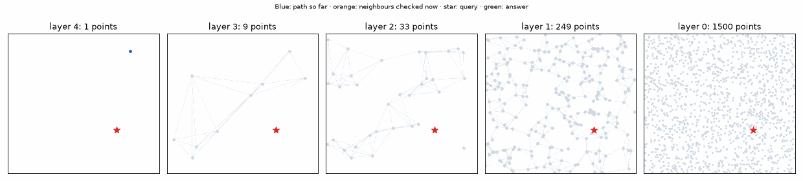
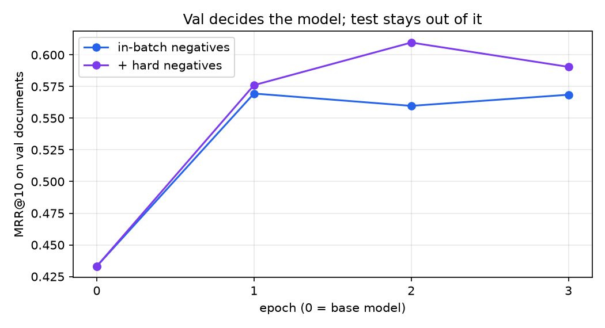
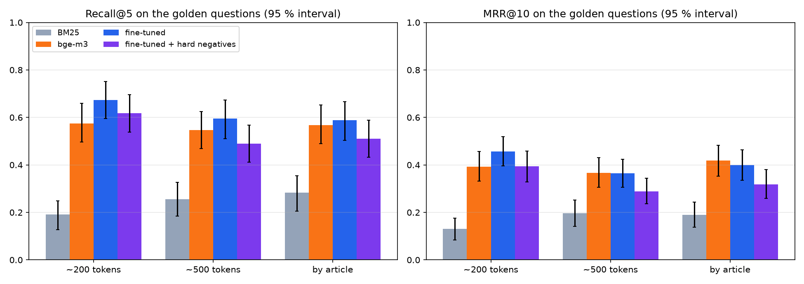
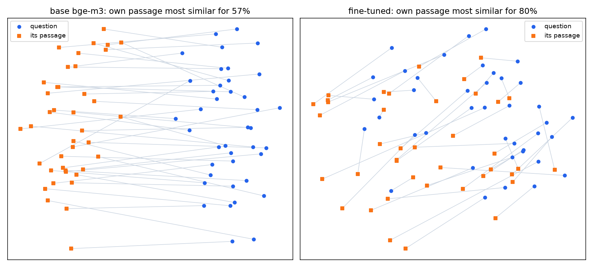
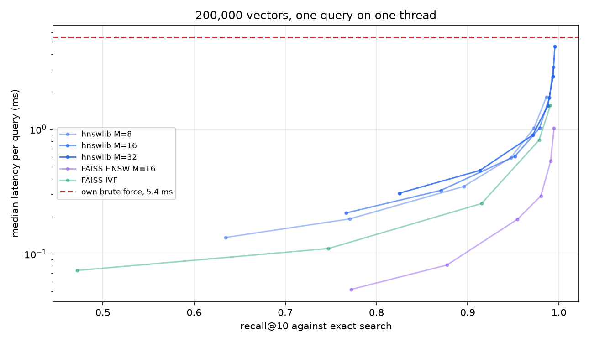

# 14 · Embeddingy a vyhľadávanie v slovenských poistných podmienkach

🇬🇧 [English version](README.md) · 📘 [Tutoriál krok za krokom](TUTORIAL.sk.md)

## TL;DR
- Nájsť správnu klauzulu pre otázku klienta v skutočných poistných podmienkach: **BM25 recall@5 0,191, základný bge-m3 0,574**, na 141 ručne skontrolovaných otázkach od poisťovní, ktoré tréning nikdy nevidel.
- Doladenie s negatívami z dávky dosiahlo **0,674** (MRR 0,392 → 0,456). Zisk je blízko hranice šumu: +0,099 v recall@5, párový 95 % interval −0,000 až 0,199.
- **Validácia vybrala zlý model.** Tvrdé negatíva vyhrali na val (MRR 0,610 vs 0,569) a prehrali na golden sade (recall@5 0,617). Výber z val som nechal, takže vykázaný model nemá voči základu preukázateľný zisk.
- Príčina je viditeľná: oba doladené modely zlepšia dlhé otázky (0,55 → 0,73) a zhoršia krátke (0,63 → 0,54). Tréningové otázky boli dlhé.
- Na 200 000 vektoroch trvá presné vyhľadávanie **5,4 ms** na dotaz a FAISS HNSW **0,19 ms** pri recall 0,955. Pre tento poistný korpus s približne 1 000 chunkmi približný index vôbec netreba.

## Problem
Systém RAG je taký dobrý, ako to, čo nájde. Tento krok odpovedá na tri otázky skôr, než na ňom postaví krok P7: kam až sa dostane hotový viacjazyčný model na slovenskom právnickom texte, pomáha doladenie na dokumentoch, ktoré nikdy nevidel, a kedy treba približný index?

Bez kapitoly v Racing Labe: vyhľadávanie je o texte a autá žiadny nemajú. Vizuálny príklad je dotaz klesajúci cez moje vlastné HNSW.



## Setup
- **Korpus:** 20 verejných slovenských poistných podmienok z 12 zdrojov, 457 strán PDF. PDF a text ostávajú v `data/`, adresy URL sú v `corpus.py`.
- **Rozdelenie podľa poisťovne, skôr než čokoľvek iné:** 11 dokumentov train, 3 val (Wüstenrot, mBank), 6 test (Generali, UNIQA, Union). Poisťovne zdieľajú formulácie, takže delenie v rámci jednej by prezrádzalo odpovede. 1,6 % až 11,1 % 8-slovných úsekov odloženého dokumentu sa vyskytuje aj v train.
- **Golden sada:** 141 otázok, v `golden.json`.
- **Tréning:** 1 399 párov otázka–pasáž z tréningových dokumentov.
- **Modely:** `BAAI/bge-m3`, len husté vektory, normalizované.
- **Hardvér:** Mac mini M4 Pro, 48 GB, MPS. Metriky: recall@1/5/10, MRR@10, nDCG@10, bootstrap 95 % intervaly cez otázky.

## How it works

**Označenia sú úseky dôkazu, nie chunky (`make_questions.py`).** Označenie je id dokumentu a znakové pozície vety, ktorá odpovedá. Chunk sa počíta ako relevantný, ak pokrýva aspoň 80 % úseku alebo obsahuje tie isté slová, lebo dva dokumenty jednej poisťovne môžu mať identickú klauzulu. Každá stratégia delenia sa tak hodnotí voči tým istým odpovediam a kód hodnotenia v `common.py` sa nemení.

**Otázky.** Lokálny model prečíta pasáž, napíše otázku klienta a odcituje odpoveď. Citát sa musí v pasáži nájsť, inak sa otázka zahodí. Presné porovnávanie najprv odmietlo 40 %, lebo extrakcia z PDF nechá v texte „b ola“ a „pre -\nskúmať“, kým model píše čisté slovo. Porovnávanie len na písmenách to vyriešilo.

**Golden sada, prečítaná po jednej.** Kandidátov napísal `gemma3:12b` a všetkých 190 prečítal Claude; vlastník nie. 49 vypadlo: 16 neprirodzených alebo mimo produktu, 13 kde dôkaz neodpovedal, 10 úlomkov príliš krátkych na posúdenie, 8 duplikátov, 2 vyžadovali otvorený dokument. 20 bolo preformulovaných. Každé rozhodnutie je v `review_golden.py`.

**Tréningové páry.** Napísal ich `qwen3:30b-a3b` z tréningových dokumentov. Claude prečítal každý 10., spolu 140: 11 malo dôkaz, ktorý odpovedá len voľne, a ostali v dátach, lebo ručne sa opravovala len golden sada.

**Doladenie (`train_embed.py`).** V dávke 8 je pasáž každej otázky pozitívna a zvyšných 7 negatívnych: `MultipleNegativesRankingLoss`, 3 epochy, learning rate 2e-5, najlepšia epocha podľa val MRR. Dávka 16 vyčerpala pamäť GPU a macOS proces zabil bez chyby v Pythone.

**Tvrdé negatíva a chyba, ktorú stojí za to si nechať.** Druhý beh pridáva pasáž, ktorú základný model chybne radí vysoko. Moja prvá verzia ťažila 200-tokenové chunky, kým pozitívne boli kratšie pasáže, a za negatíva brala aj susedov prekrývajúcich sa s odpoveďou. Val MRR kleslo z 0,433 na 0,185–0,277 a recall@5 bolo najhoršie na dlhých článkoch (0,078). Vzorec naznačuje, že sa model naučil „dlhý text je zlý“. Ťažba v rovnakom formáte pasáží a preskakovanie prekryvov to opravili.



**Moje vlastné indexy (`index.py`).** `BruteForce` je normalizovaný skalárny súčin plus `argpartition`. `TinyHNSW` je malé HNSW v NumPy: každý bod dostane náhodnú najvyššiu vrstvu, horné vrstvy sú riedke diaľnice, hľadanie po nich kráča lačne nadol a širšie hľadanie dostane len spodná vrstva. Na 1 500 bodoch v 2D vytvorí vrstvy s 1 500 / 249 / 33 / 9 / 1 bodmi a dosiahne recall@5 0,998 pri `ef` 5 a 1,0 od `ef` 10.

## Results

**Vyhľadávanie, 141 golden otázok, chunky ~200 tokenov.** Vybraný model bol určený na val skôr, než tieto čísla existovali.

| Systém | Recall@1 | Recall@5 (95 %) | Recall@10 | MRR@10 (95 %) | nDCG@10 |
|---|---|---|---|---|---|
| BM25 | 0,078 | 0,191 (0,128–0,248) | 0,248 | 0,130 (0,085–0,175) | 0,158 |
| bge-m3, základ | 0,248 | 0,574 (0,496–0,660) | 0,702 | 0,392 (0,331–0,457) | 0,467 |
| Doladený, negatíva z dávky | 0,291 | **0,674** (0,596–0,752) | **0,809** | **0,456** (0,395–0,518) | 0,541 |
| Doladený + tvrdé negatíva (**vybraný na val**) | 0,270 | 0,617 (0,539–0,695) | 0,709 | 0,394 (0,329–0,458) | 0,469 |

Párovo na tých istých otázkach, oproti základu:

| Model | Rozdiel recall@5 (95 %) | Rozdiel MRR@10 (95 %) |
|---|---|---|
| Vybraný (tvrdé negatíva) | +0,043 (−0,071 až 0,142) | +0,001 (−0,084 až 0,081) |
| Negatíva z dávky | +0,099 (−0,000 až 0,199) | +0,064 (−0,013 až 0,141) |

Model s negatívami z dávky porazil vybraný model v MRR o 0,062 (0,008 až 0,118). Neprešiel som naň: bol by to výber na testovacej sade a číslo by už nič neznamenalo. Tabuľka ukazuje oba a poctivé čítanie je, že val tu zlyhala.

**Delenie na chunky.** Recall@5 / MRR@10:

| Stratégia | Chunky | Priemer znakov | Dosiahnuteľný dôkaz | BM25 | Základ | Z dávky | Tvrdé negatíva |
|---|---|---|---|---|---|---|---|
| ~200 tokenov, prekryv 40 | 1 113 | 741 | 98,6 % | 0,191 / 0,130 | 0,574 / 0,392 | 0,674 / 0,456 | 0,617 / 0,394 |
| ~500 tokenov, prekryv 100 | 446 | 1 851 | 100 % | 0,255 / 0,196 | 0,546 / 0,366 | 0,596 / 0,365 | 0,489 / 0,288 |
| Podľa nadpisu článku | 527 | 1 510 | 100 % | 0,284 / 0,189 | 0,567 / 0,418 | 0,589 / 0,400 | 0,511 / 0,318 |



Pri základnom bge-m3 ostáva delenie v rámci šumu. Doladené modely strácajú viac na dlhých chunkoch, lebo sa učili na krátkych pasážach. BM25 je s dlhšími chunkmi lepšie: má viac slov na zhodu.

**V 2D.** Vzorka 40 otázok s ich pasážami, PCA zvlášť pre každý model. Základný model drží otázky a pasáže v dvoch oddelených oblakoch; doladenie ich premieša. V plných 1 024 dimenziách je vlastná pasáž najbližšia zo 40 pri 57 % otázok pred a 80 % po. PCA je len ilustrácia a toto je ľahšia úloha než hľadanie v celom korpuse.



**Benchmark indexov: 200 000 pasáží zo slovenskej Wikipédie, 1 024 dimenzií, 2 000 dotazov, recall@10 voči presnému hľadaniu.** Latencia je pre jeden dotaz na jednom vlákne.

| Index | Nastavenie | Recall@10 | Medián | p95 | Stavba | Veľkosť |
|---|---|---|---|---|---|---|
| Vlastný brute force | | 1,000 | 5,45 ms | 5,94 ms | 0 | 819 MB |
| hnswlib | M 16, ef 50 | 0,952 | 0,61 ms | 0,79 ms | 54 s | 849 MB |
| hnswlib | M 16, ef 200 | 0,990 | 1,79 ms | 2,27 ms | 54 s | 849 MB |
| FAISS HNSW | M 16, ef 50 | 0,955 | **0,19 ms** | 0,24 ms | 22 s | 848 MB |
| FAISS HNSW | M 16, ef 200 | 0,991 | 0,56 ms | 0,71 ms | 22 s | 848 MB |
| FAISS IVF | nprobe 16 | 0,915 | 0,25 ms | 0,29 ms | **2,8 s** | 825 MB |
| FAISS IVF | nprobe 128 | 0,991 | 1,55 ms | 1,68 ms | 2,8 s | 825 MB |



Veľkosť sa takmer nemení, lebo ju určujú vektory; graf pridá pár percent. HNSW je asi 29× rýchlejšie než presné hľadanie pri recall 0,955 a posun z recall 0,955 na 0,991 stojí asi 3× viac času. Obe knižnice používajú ten istý algoritmus, takže odstup hnswlib od FAISS je tu aspoň čiastočne v tom, ako sa volajú z Pythonu. To som neoddeľoval.

## Error analysis
Pri vybranom modeli: 33 otázok sa dostalo do top 5, 27 z neho vypadlo, 54 stále chýba a 41 nie je ani v top 10.

- **Rozhoduje dĺžka otázky.** Toto je hlavný nález:

| Otázky | Počet | Základ | Z dávky | Tvrdé negatíva |
|---|---|---|---|---|
| Do 80 znakov | 41 | 0,634 | 0,537 | 0,488 |
| 80 znakov a viac | 100 | 0,550 | 0,730 | 0,670 |

  Tréningové otázky majú v priemere 144 znakov, golden 108. Model sa naučil dlhé otázky plné situácie a zhoršil sa na krátkych priamych, aké klient tiež napíše. Val otázky pochádzajú od toho istého pisateľa ako train (141 znakov), takže val to vidieť nemohla, a preto vybrala zle.
- **Podľa dokumentu.** Najviac získali cestovné podmienky UNIQA (0,41 → 0,63), kým `uniqa_dcr` (0,62 → 0,52) a `union_vpp` (0,59 → 0,56) stratili. Pri 13–29 otázkach na dokument to ber ako náznak.
- **Takmer rovnaké texty medzi dokumentmi.** Podobné klauzuly v rôznych dokumentoch si konkurujú a otázka málokedy povie, o ktorú poisťovňu ide. Niektoré „chyby“ sú správne klauzuly zo zlého dokumentu.
- **BM25** trpí skloňovaním a slovníkom: klienti píšu „ukradli“, kde podmienky hovoria „odcudzenie“. Nemá tu stemming.

## What I learned
- **Kedy sa doladenie embeddingov oplatí?** Keď je medzera medzi tým, ako sa ľudia pýtajú, a ako sú písané dokumenty, a keď tréningové otázky vyzerajú ako skutočné. Zisk tu bol reálny na otázkach podobných tréningovým a záporný na ostatných. Doladenie posúva model k tréningovému rozdeleniu, takže to rozdelenie musí byť správne.
- **Val sada z rovnakého zdroja ako train meria nesprávnu vec.** Golden sada odhalila, čo val nemohla: iného pisateľa. Dáta na výber sa majú od tréningových líšiť tak, ako sa líši produkcia.
- **Po pohľade na test sa znova nevyberá.** Lákalo to. Vykázať horšie číslo s dôvodom má väčšiu cenu než lepšie číslo, ktorému nikto nemôže veriť.
- Negatíva učia to, čím sa líšia od pozitívnych. Ak je to dĺžka, model sa naučí dĺžku.
- Tichá smrť procesu môže byť pamäť: žiadny výpis chyby neznamená, že nie je príčina.
- Po indexe nesiahaj zo zvyku. 5 ms presného hľadania nad 200 000 vektormi väčšine systémov RAG stačí.
- Úseky dôkazu namiesto id chunkov spravili z porovnania delenia hračku. Toto jedno rozhodnutie ušetrilo celému pokusu nové označovanie.

**Pre P7:** bezpečná voľba je dnes základný model. Lepšie doladenie by potrebovalo krátke otázky v tréningu a val sadu od iného pisateľa. Golden sada v tomto repozitári je na toto rozhodnutie spotrebovaná, takže treba nové otázky.

## Run it
```bash
uv sync
uv run python corpus.py                      # stiahne PDF, zapíše data/docs.jsonl
uv run python make_questions.py golden       # aj val, train; --second pre druhý prechod
uv run python review_golden.py               # použije ručnú kontrolu, zapíše golden.json
uv run python evaluate.py                    # baseline
uv run python train_embed.py inbatch
uv run python train_embed.py hardneg --hard
uv run python evaluate.py --model inbatch=models/inbatch --model hardneg=models/hardneg
uv run python select_model.py                # vyberá na val
uv run python embed_wiki.py                  # potrebuje priečinok dát z kroku 12 vedľa tohto
uv run python ann_benchmark.py               # na nevyťaženom stroji
uv run python analysis.py && uv run python projection.py
uv run python hnsw_gif.py && uv run python plot.py
```

Dlhé kroky spúšťaj cez `nohup caffeinate -i` a pred tréningom zastav modely v Ollame: delia sa o pamäť GPU.

## Limitations
- **Otázky napísali LLM** a boli skontrolované, nie sú to skutočné záznamy klientov. Práve preto vznikol nesúlad v dĺžke.
- **141 otázok** dáva široké intervaly. Väčšina rozdielov medzi doladenými modelmi a základom sa tu preukázať nedá.
- **Každá otázka má jednu označenú odpoveď**, hoci korpus má podobné klauzuly inde, takže skutočná relevantnosť je o niečo vyššia, než je namerané.
- **Jeden seed na beh** a intervaly pokrývajú otázky, nie náhodnosť tréningu.
- **Kontrolu robil Claude**, raz. Právnik by niektorý dôkaz posúdil inak.
- **Len husté vektory.** Riedky výstup bge-m3 a rerankovanie testované nie sú, ani hybridné hľadanie s BM25.
- **Benchmark ANN používa Wikipédiu, nie poistný text**, a pasáže orezané na 128 tokenov. Meria indexy, nie relevantnosť. Embedovanie trvalo 3 204 s pri zdieľanom GPU.
- **Ťažba tvrdých negatív je jeden recept**, jedno negatívum na pár, zo základného modelu.
- Artefakty z PDF ostali v texte („b ola“) a dostávajú sa do modelov aj hodnotenia.
